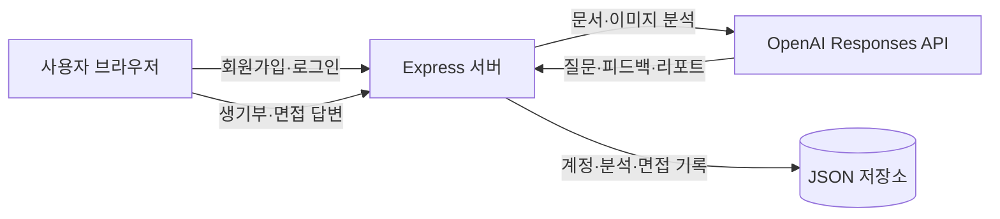

# 면접ON

> 학교생활기록부를 읽고 예상 질문을 생성하며, 답변을 학생부 근거와 비교해 코칭하는 대학 면접 연습 서비스

생기부의 활동을 단순히 요약하는 데서 끝나지 않고, 면접관이 확인할 만한 지점과 꼬리질문을 찾아 줍니다. 사용자는 코칭 연습 또는 실전 모의면접을 진행하고 답변별 피드백과 종합 리포트를 받을 수 있습니다.

## 주요 기능

- **생기부 분석**: PDF, DOC, DOCX, TXT, JPG, PNG, WEBP, GIF 지원
- **학생부 기반 질문 생성**: 활동 근거, 평가 의도, 예상 꼬리질문 제공
- **두 가지 면접 모드**
  - 코칭 연습: 답변 직후 점수와 개선 답변 확인
  - 실전 모의면접: 중간 피드백 없이 진행 후 종합 평가
- **음성 답변 입력**: 지원 브라우저에서 한국어 음성 인식 사용
- **종합 리포트**: 구체성, 논리, 진정성, 전달력, 기록 일치도 평가
- **계정 기능**: 이메일 회원가입, 로그인·로그아웃, 30일 로그인 유지
- **사용자별 데이터 격리**: 다른 사용자의 분석 및 면접 기록 접근 차단
- **초대 코드**: 공개 배포 시 승인된 친구만 회원가입 가능

## 동작 구조



현재 버전은 소규모 친구 테스트를 위한 JSON 저장소를 사용합니다. 계정 수가 늘어나면 Firebase Authentication과 Firestore로 이전할 예정입니다.

## 기술 스택

| 영역 | 기술 |
| --- | --- |
| 프론트엔드 | HTML, CSS, Vanilla JavaScript |
| 백엔드 | Node.js 22+, Express 5 |
| AI | OpenAI Responses API, Structured Outputs |
| 파일 업로드 | Multer |
| 인증 | scrypt 비밀번호 해시, HttpOnly 세션 쿠키 |
| 저장소 | 로컬 JSON 파일 |
| 배포 | GitHub Actions, Render Blueprint |

## 로컬 실행

### 1. 저장소 내려받기

```bash
git clone <repository-url>
cd interview_ai
npm ci
```

### 2. 환경변수 설정

```bash
cp .env.example .env
```

`.env`에 새로 발급한 OpenAI API 키를 입력합니다.

```env
OPENAI_API_KEYS=sk-your-new-key
OPENAI_MODEL=gpt-6.2-sol
PORT=3000
INVITE_CODE=your-private-invite-code
```

| 변수 | 필수 여부 | 설명 |
| --- | --- | --- |
| `OPENAI_API_KEYS` | 필수 | 쉼표로 구분한 하나 이상의 서버용 API 키 |
| `OPENAI_API_KEY` | 선택 | 키가 하나일 때 사용할 수 있는 대체 변수 |
| `OPENAI_MODEL` | 선택 | 사용할 모델. 기본값은 `gpt-6.2-sol` |
| `PORT` | 선택 | 서버 포트. 기본값은 `3000` |
| `INVITE_CODE` | 배포 시 권장 | 회원가입에 필요한 친구용 초대 코드 |
| `DATA_DIR` | 선택 | JSON 데이터 저장 경로 |

API 키는 브라우저 코드에 넣지 말고 반드시 서버 환경변수로만 관리하세요.

### 3. 개발 서버 실행

```bash
npm run dev
```

브라우저에서 [http://localhost:3000](http://localhost:3000)을 엽니다.

## 사용 흐름

1. 계정을 만들고 로그인합니다.
2. 생기부 문서 또는 촬영 이미지를 업로드합니다.
3. 지원 대학과 학과를 입력해 예상 질문을 생성합니다.
4. 코칭 연습 또는 실전 모의면접을 선택합니다.
5. 답변을 입력하거나 음성으로 말합니다.
6. 답변별 피드백과 최종 면접 리포트를 확인합니다.

로그인 기능 도입 전에 로컬에 저장된 기록은 첫 번째로 가입한 계정에 자동으로 연결됩니다.

## 데이터 및 보안

- 비밀번호 원문을 저장하지 않고 `scrypt` 해시만 저장합니다.
- 로그인 토큰 원문은 HttpOnly 쿠키에만 저장하고 서버에는 SHA-256 해시를 저장합니다.
- 운영 환경의 인증 쿠키에는 `Secure`와 `SameSite=Lax`가 적용됩니다.
- 모든 프로필 및 면접 API에서 로그인 사용자와 데이터 소유자를 확인합니다.
- 원본 생기부는 로컬 데이터베이스에 저장하지 않습니다.
- 문서 파일은 OpenAI Files API에 전달하고 분석 종료 후 삭제를 시도합니다.
- 이미지는 요청 시 Base64 입력으로 전달하며 별도 파일로 저장하지 않습니다.
- `.env`, Firebase 서비스 계정 파일, 사용자 데이터는 `.gitignore`에서 제외됩니다.

> 학생부에는 민감한 개인정보가 포함될 수 있습니다. 실제 서비스로 확장하기 전 사용자 동의, 보존 기간, 삭제 정책, 암호화 및 접근 기록 정책을 추가해야 합니다.

## 테스트

```bash
npm test
node --check server.js
node --check public/app.js
```

테스트에서는 다음 항목을 확인합니다.

- 비밀번호 해시 및 검증
- 세션 쿠키와 로그아웃
- 초대 코드 보호
- 사용자별 데이터 격리
- 기존 데이터의 최초 계정 연결
- 이미지 입력 형식
- Structured Outputs 스키마
- 서버 상태 및 정적 페이지 제공

GitHub Actions도 push와 pull request마다 동일한 테스트와 문법 검사를 실행합니다.

## Render 배포

GitHub Pages는 정적 사이트 전용이므로 Express 서버와 OpenAI API 호출을 실행할 수 없습니다. 이 프로젝트는 GitHub 저장소를 Render 웹 서비스에 연결하는 방식으로 배포합니다.

1. 프로젝트를 **비공개 GitHub 저장소**에 push합니다.
2. Render에서 **New Blueprint**를 선택합니다.
3. GitHub 저장소를 연결하면 루트의 `render.yaml`이 설정을 불러옵니다.
4. Render 환경변수에 `OPENAI_API_KEYS`와 `INVITE_CODE`를 입력합니다.
5. 배포가 끝나면 제공된 `onrender.com` 주소를 공유합니다.

현재 JSON 저장소는 재배포 후에도 데이터를 유지해야 하므로 `render.yaml`에서 Starter 웹 서비스와 영속 디스크를 사용합니다. Firebase/Firestore 전환 후에는 영속 디스크 설정을 제거할 수 있습니다.

## 프로젝트 구조

```text
.
├── .github/workflows/test.yml  # GitHub Actions
├── lib/
│   ├── auth.js                 # 비밀번호 및 세션 처리
│   ├── openai.js               # AI 분석과 피드백
│   ├── schemas.js              # Structured Outputs 스키마
│   └── store.js                # JSON 저장소
├── public/
│   ├── app.js                  # 화면 및 클라이언트 로직
│   ├── index.html
│   └── styles.css
├── storage/                    # 로컬 데이터 위치
├── test/                       # Node 테스트
├── render.yaml                 # Render Blueprint
└── server.js                   # Express API 서버
```

## 예정 작업

- [ ] Firebase Authentication으로 계정 시스템 이전
- [ ] Firestore 사용자별 데이터 저장
- [ ] 이메일 인증 및 비밀번호 재설정
- [ ] 계정 탈퇴와 사용자 데이터 일괄 삭제
- [ ] API 사용량 제한과 관리자 화면
- [ ] 개인정보 보존 기간 및 동의 절차
- [ ] 모바일 업로드 UX 개선

## 주의사항

- `.env`와 서비스 계정 JSON을 GitHub에 올리지 마세요.
- 예제 파일이라도 실제 API 키를 넣지 마세요.
- 키가 한 번이라도 공개 저장소나 Git 기록에 포함됐다면 삭제만 하지 말고 해당 키를 폐기한 뒤 재발급하세요.
- 이 프로젝트는 현재 소규모 테스트용 MVP이며, 불특정 다수를 대상으로 한 운영 환경의 모든 보안·개인정보 요구사항을 충족하는 완성형 서비스는 아닙니다.
